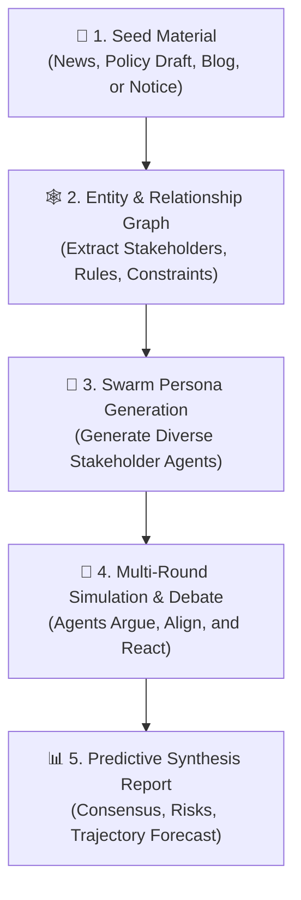

# MiroFish: Multi-Agent Swarm Intelligence & Predictive Simulation

## Overview
MiroFish is an open-source AI prediction engine powered by multi-agent swarm simulation and knowledge graphs. Instead of giving a single static response, MiroFish constructs a high-fidelity digital sandbox populated by diverse synthetic agent personas (e.g., employees, employers, regulators, compliance officers) that interact over multiple rounds to model real-world social emergence and predict future trajectories.

---

## When to Use MiroFish
- **Policy & Compliance Forecasting**: Predict how employers and employees will react to new EPFO notifications, wage ceiling hikes, or penalties before publishing advice.
- **Content & Campaign Stress-Testing**: Test tweet threads, blog topics, or press releases against simulated stakeholder sentiment to eliminate misinterpretations.
- **Scenario Planning & "What-If" Analysis**: Inject variables mid-simulation to evaluate best-case, worst-case, and most-likely outcomes.
- **Adversarial Red-Teaming**: Test defenses against statutory notices (Section 7A, 14B) by simulating the enforcement officer's counter-arguments.

---

## The 4-Stage Simulation Lifecycle

---

## Lightweight Execution & RAM Discipline
To ensure maximum speed and keep memory consumption minimal:
1. **On-Demand Execution**: Run simulations only when needed; never keep background simulation workers running indefinitely.
2. **Quota-Conscious Routing**: Route routine persona interactions through fast models (`gemini-2.5-flash` or FreeLLMAPI) to achieve high throughput with near-zero latency.
3. **Structured Synthesis**: Synthesize raw agent interactions into an actionable 1-page markdown prediction matrix.
